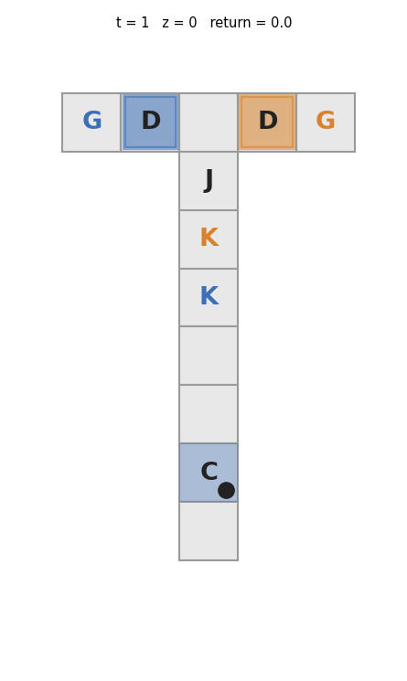
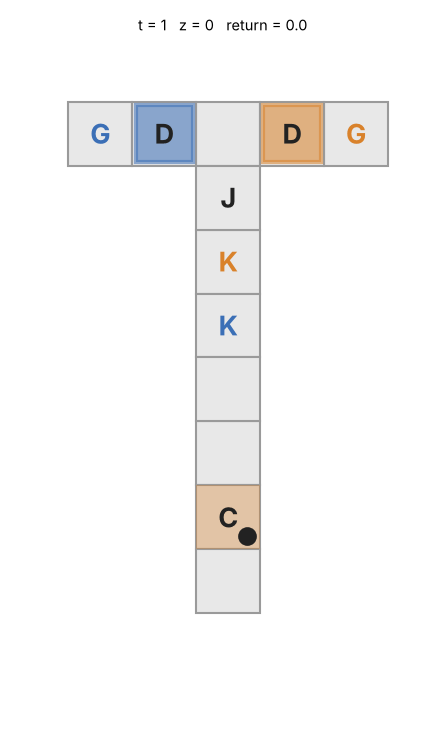
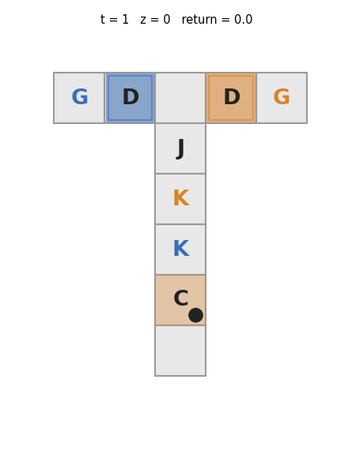
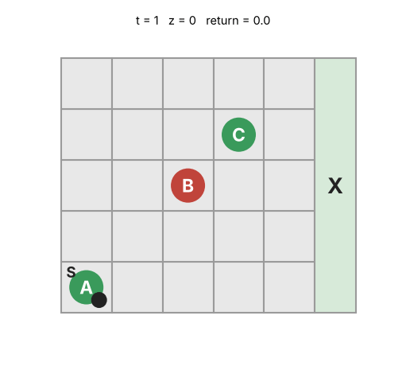
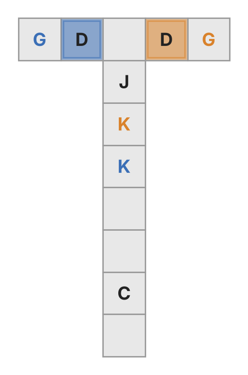
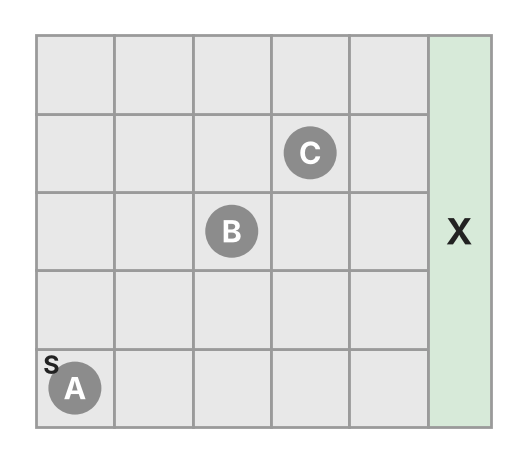
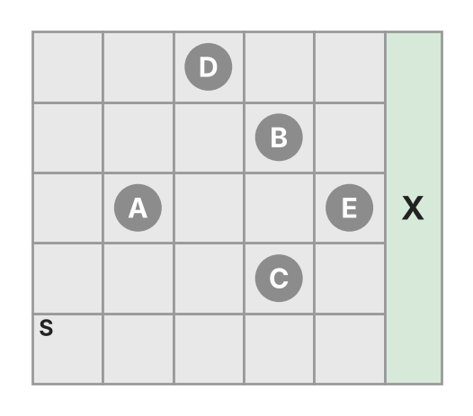

# Policy Iteration for Logic-Constrained POMDPs under Fixed Memory Budgets

This repository contains the code and the experiment configurations for the paper
*Policy Iteration for Logic-Constrained POMDPs under Fixed Memory Budgets* (L4DC 2027, under review).

The agent acts in a POMDP whose task is a temporal-logic specification $`\varphi`$. Its controller has a fixed, declared
memory $`\mathcal Z`$ that is chosen before planning. Every value in the paper is computed exactly on the product of the
POMDP with the automaton of $`\varphi`$, so nothing is sampled and every run is reproducible from its seed.

<table>
  <tr>
    <td align="center"></td>
    <td align="center"></td>
    <td align="center"></td>
    <td align="center"></td>
  </tr>
  <tr>
    <td align="center" colspan="2"><sub>CPI for (P1) with one memory bit (L = 5, no slack).<br>For cue 1 it sets z = 1 at the first step, and for either cue<br>it takes the key of the cued side and reaches the cued goal.</sub></td>
    <td align="center"><sub>CPI for (P1) without memory<br>(L = 3, slack 4). It learned<br>to step back once for this cue,<br>so its position carries the cue.</sub></td>
    <td align="center"><sub>LBS + CPI for (P2) on three rocks at c = 0.86.<br>The latch adds one bit, so z takes four values.<br>A dashed line marks a check and a ring a sampled rock.</sub></td>
  </tr>
</table>
<p align="center"><sub>Every policy shown was computed by the methods of the paper. Each frame shows the time t, the memory state z and the discounted return so far.</sub></p>

## The two problems

A policy in $`\Pi`$ is time-indexed and acts on an agent state. At time $`t`$ it picks an action $`a`$ and the next memory
state $`z`$ from the current observation $`y`$, the previous memory state $`z_-`$ and the automaton state $`q`$, with
probability $`\pi_t(a,z\mid y,z_-,q)`$. The agent can track $`q`$ because the labels are read from the observations.

```math
\textbf{(P1)}\quad \max_{\pi\in\Pi}\; J_\varphi(\pi)
\qquad\qquad
\textbf{(P2)}\quad \max_{\pi\in\Pi}\; J_r(\pi)\quad\text{subject to}\quad J_\varphi(\pi)\ge c
```

```math
J_r(\pi)=\mathbb E^\pi\Big[\sum_{t=1}^{T}\gamma^{t-1}\,r(S_t,A_t)\Big],
\qquad
J_\varphi(\pi)=\mathbb P^\pi\big(L(Y_1)\,L(Y_2)\cdots L(Y_T)\models\varphi\big).
```

## Methods

| Method | What it does | Code |
|---|---|---|
| CPI | Conservative policy iteration with backward Gauss–Seidel sweeps. For (P1) each stage is greedy on the satisfaction value. For (P2) each stage is greedy on $`Q_r+\lambda_t Q_\varphi`$ with the smallest stage multiplier $`\lambda_t`$ that keeps $`J_\varphi\ge c`$ (Proposition 2), so every step after the first feasible one stays feasible. | `cpi.py` |
| LBS | Bisection on the multiplier of $`L_\lambda=J_r+\lambda J_\varphi`$ (Algorithm 2). It returns a latched mixture of two policies that uses one extra memory bit and meets $`J_\varphi=c`$ exactly, with the certificate of Theorem 4. | `pricing.py` |
| LBS + CPI | CPI on the output of LBS, with the latch bit as part of the memory. | `pricing.py` |
| Trial-and-Error | The same schedule as CPI, but each stage moves toward the reward-greedy rule with the largest step that keeps $`J_\varphi\ge c`$. | `cpi.py` |
| CGCP | Column generation over belief-space policies (Walraven and Spaan, 2018) with SARSOP pricing. It has no memory budget and gives an upper bound over all policies. | `cgcp_sarsop.py`, `cgcp_belief.py` |

For LBS the mixture weight, the guarantee and the certificate are

```math
\theta=\frac{c-J_\varphi(d_{\lambda'})}{J_\varphi(d_{\lambda''})-J_\varphi(d_{\lambda'})},
\qquad
J_r(\pi_\theta)\;\ge\;\bar v_2(c)-\theta\,\epsilon(\lambda'')-(1-\theta)\,\epsilon(\lambda')-C,
\qquad
C=(\lambda''-\lambda')\,\theta(1-\theta)\big[J_\varphi(d_{\lambda''})-J_\varphi(d_{\lambda'})\big].
```

Here $`\bar v_2(c)`$ is the value of (P2) over mixtures of policies in $`\Pi`$, and $`\epsilon(\lambda)`$ is how far the inner
ascent at $`\lambda`$ falls short of $`\max_\Pi L_\lambda`$. With $`R`$ the range of $`J_r`$ and $`\tilde\kappa=J_\varphi(\tilde\pi)-c`$
the slack of the (P1) policy that LBS starts from, $`n`$ bisection steps give $`C\le R/(2^{n+2}\tilde\kappa)`$. A certificate
below $`\epsilon`$ therefore needs only $`n=\lceil\log_2(R/(4\tilde\kappa\epsilon))\rceil`$ steps.

## Environments

| Environment | Problem | Code | Presets |
|---|---|---|---|
| Cue–key–door T-maze | (P1) | `tmaze.py`, `tmaze_route.py` | `tmaze_L{L}_s{W}_m{m}` |
| RockSample | (P2) | `rocksample.py` | `rocksample3_tight`, `rocksample5_tight` |
| Polar maze | (P2) | `tmaze_gap.py` | `tgap_K{K}_s{s}` |

<p align="center">
  
  &nbsp;&nbsp;
  
  &nbsp;&nbsp;
  
</p>
<p align="center"><sub>The T-maze with L = 5 (C cue, K keys, J junction, D doors, G goals), and RockSample with three and five rocks (S start, X exit, green good, red bad).</sub></p>

The polar maze appears as the survey maze (`tmaze_gap.py`, `tgap_*`) in older notes and in the code. Every setting,
seed and threshold of the paper is listed in **[EXPERIMENTS.md](EXPERIMENTS.md)**.

## Install

Python 3.10 or later. The code runs on Windows, macOS and Linux.

```bash
python -m pip install -r requirements.txt
python -m pytest -q tests          # about a minute, one test is skipped without the original RockSample suite
```

CGCP also needs the `pomdpsol` binary of SARSOP. [EXPERIMENTS.md](EXPERIMENTS.md#cgcp-with-sarsop) explains how to build it.

## Quick start

```bash
# (P1) on a T-maze with one memory bit
python run.py --kind cpi --task tmaze_L5_s2_m1 --memory-size 2 --start copy --ties random

# (P2) on RockSample with three rocks at c = 0.86, as in the paper
python run.py --kind cpi --task rocksample3_tight --levels 0.86 --bad-rock-penalty 0 --seed 0

# animate one episode of the policy that run saved (writes animations/<task>_seed0_ep0.gif)
python env_animate.py rocksample3_tight --policy runs/single/<job id>/policy_0.86.npz \
    --set bad_rock_penalty=0 --episode-seed 0 --annotate
```

Each run writes `runs/single/<job id>/` with `result.json` (exact $`J_\varphi`$ and $`J_r`$), `log.json` (every sweep)
and the final policy as `.npz`.

## Reproducing the paper

| Result | Command | Time on 14 workers |
|---|---|---|
| (P1) T-maze and slack in place of memory | `python suite.py --result remark7 --workers 14` | a few minutes |
| (P2) polar maze | `python suite.py --result prop5 --workers 14` | a few minutes |
| (P2) RockSample, all our methods | `python suite.py --result thm6 --workers 14` | about 3 hours |
| CGCP on three rocks and on the polar maze | `python cgcp_sarsop.py ...`, see [EXPERIMENTS.md](EXPERIMENTS.md#cgcp-with-sarsop) | about 33 minutes per threshold |
| CGCP on five rocks | see [EXPERIMENTS.md](EXPERIMENTS.md#cgcp-with-sarsop) | 3 to 4 hours per threshold |
| Tables, figures and in-text numbers | `python suite.py --report` and `python plot_p2.py --no-npg --cloud-ours-only` | seconds |

The names after `--result` follow an older numbering of the paper. `suite.py --result all` also runs the chain of
Example 1 (`prop4`) and the label-noise study (`lemma1`). Every runner resumes, so an interrupted command can simply be
run again. [EXPERIMENTS.md](EXPERIMENTS.md#run-times) lists the run time of every method.

<p align="center">
  
  
</p>
<p align="center"><sub>(P2) on RockSample. Left: the best feasible reward found within N sweeps. Right: reward against satisfaction for every two-node policy evaluated, with the median result of each method and CGCP.</sub></p>

## Repository layout

| File | Contents |
|---|---|
| `tmaze.py`, `rocksample.py`, `tmaze_gap.py` | The environments, their labels and their automata |
| `chain.py`, `twostep.py` | The small instances behind Example 1 |
| `logic.py` | Automata as dictionaries |
| `tasks.py` | `make_task` and every preset (`python tasks.py --list`) |
| `product.py` | The exact product model as sparse matrices, and exact evaluation of a policy |
| `cpi.py` | CPI for (P1) and (P2), Trial-and-Error, the starting policies and policy files |
| `pricing.py` | LBS, its certificate and the CPI polish |
| `cgcp_sarsop.py`, `cgcp_belief.py` | CGCP with SARSOP pricing, and exact evaluation of belief-space policies |
| `cheap_bounds.py` | The fully observable and fast informed upper bounds on RockSample |
| `tmaze_route.py` | The memoryless route policy that carries the cue in its position |
| `tgap_search.py` | The best policy found in $`\Pi`$ where $`v_2(c)`$ has no closed form |
| `experiments.py`, `paper.py`, `suite.py` | Every experiment as a resumable job list, and the runner |
| `run.py` | One method on one task and one seed |
| `report_paper.py`, `plot_p2.py`, `plot_tmaze_slack.py`, `plot_tmaze_curves.py` | Tables, figures and in-text numbers from the run logs |
| `env_visualize.py`, `env_animate.py`, `make_gallery.py` | Environment figures, GIF animations of single episodes, and the gallery of learned policies |
| `simulate.py`, `policies.py` | A simulator and controllers as functions |
| `configs/` | Every preset as JSON |
| `figures/`, `examples/` | Environment figures, example policies and GIFs |
| `tests/` | Unit tests for the environments and the methods |

## Figures and animations

`make_gallery.py` makes the animations of learned policies at the top of this page. It runs each method with its
policy saved into `runs_gallery/`, picks episodes, and writes annotated GIFs to `examples/`.

```bash
python make_gallery.py                   # the T-maze and three-rock GIFs, about a minute
python make_gallery.py --five-rocks      # also LBS + CPI on five rocks at c = 0.96, about 10 more minutes
python make_gallery.py --only tmaze      # only the entries whose name starts with learned_tmaze
```

To add an animation, append an entry to `GALLERY` in `make_gallery.py`. An entry is a file name, a job as in
`paper.py` with `save=True`, and how to pick episodes (`'cues'` gives one episode per cue value, and `'check'` gives the
first episode in which the agent checks a rock and $`\varphi`$ holds). Then reference the new GIF here with an
`_<episode>.gif" width="150">` tag. Commit the GIFs in `examples/`, which are 40 to 60 KB
each, and leave `runs_gallery/` and `animations/` out of the repository.

For a single policy, `env_animate.py` takes any policy file that a run saved.

```bash
python env_animate.py tmaze_L5_s0_m1 --seed 0 --policy runs/single/<job id>/policy_P1.npz --annotate
python env_animate.py rocksample3_tight --policy runs_gallery/gallery/<job id>/policy_bisect.npz \
    --set bad_rock_penalty=0 --episode-seed 3 --annotate
python env_visualize.py tmaze_L5_s2_m1 rocksample3 rocksample5            # the layouts, figures/<task>_seed0.png
```

- **Which file.** CPI saves `policy_P1.npz` for (P1) and `policy_<c>.npz` for (P2). LBS + CPI saves
  `policy_bisect.npz`, which carries its own memory size and the latch as the initial memory distribution.
- **Seeds.** `--seed` must be the seed of the run, because it places the keys of the T-maze. `--episode-seed` chooses
  the cue and the rocks of the episode.
- **Environment overrides.** Pass the same overrides as the run, such as `--set bad_rock_penalty=0` on RockSample.
- **Frames.** `--annotate` adds the time, the memory state and the return to every frame, and says on the last frame
  whether $`\varphi`$ holds. In RockSample a dashed line marks a check and a ring marks a sampled rock.
- **Format.** The GIFs are written with Pillow, so ffmpeg is not needed. GitHub plays GIFs inline.
- **Polar maze.** `env_visualize.py` has no drawing for the polar maze yet, so it has no animations.

## Citation

```bibtex
@inproceedings{goswami2027policy,
  title     = {Policy Iteration for Logic-Constrained {POMDP}s under Fixed Memory Budgets},
  author    = {Goswami, Arka Ian and Mahajan, Aditya},
  booktitle = {Proceedings of the 9th Annual Learning for Dynamics and Control Conference},
  series    = {Proceedings of Machine Learning Research},
  year      = {2027},
  note      = {Under review}
}
```
