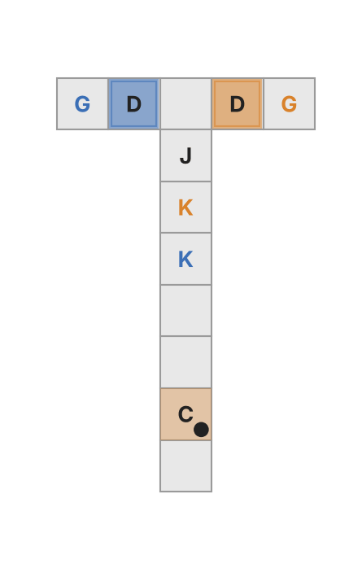

# Policy Iteration for Logic-Constrained POMDPs under Fixed Memory Budgets
The agent acts in a POMDP whose task is a temporal-logic specification $`\varphi`$. Its controller has a fixed, declared
memory $`\mathcal Z`$ that is chosen before planning. Every value in the paper is computed exactly on the product of the
POMDP with the automaton of $`\varphi`$, so nothing is sampled and every run is reproducible from its seed.

<table>
  <tr>
    <td align="center"></td>
    <td align="center"></td>
</table>


## Problems
A policy in $`\Pi`$ is time-indexed and acts on an agent state. At time $`t`$ it picks an action $`a`$ and the next memory
state $`z`$ from the current observation $`y`$, the previous memory state $`z_-`$ and the automaton state $`q`$, with
probability $`\pi_t(a,z\mid y,z_-,q)`$. The agent can track $`q`$ because the labels are read from the observations.

```math
\textbf{(P1)}\quad \max_{\pi\in\Pi}\; J_\varphi(\pi)
\qquad\qquad
\textbf{(P2)}\quad \max_{\pi\in\Pi}\; J_r(\pi)\quad\text{subject to}\quad J_\varphi(\pi)\ge c
```

```math
J_r(\pi)=\mathbb E^\pi\Big[\sum_{t=1}^{T}\gamma^{t-1}\,r(S_t,A_t)\Big],
\qquad
J_\varphi(\pi)=\mathbb P^\pi\big(L(Y_1)\,L(Y_2)\cdots L(Y_T)\models\varphi\big).
```

## Methods

| Method | What it does | Code |
|---|---|---|
| CPI | Conservative policy iteration with backward Gauss–Seidel sweeps. For (P1) each stage is greedy on the satisfaction value. For (P2) each stage is greedy on $`Q_r+\lambda_t Q_\varphi`$ with the smallest stage multiplier $`\lambda_t`$ that keeps $`J_\varphi\ge c`$ (Proposition 2), so every step after the first feasible one stays feasible. | `cpi.py` |
| LBS | Bisection on the multiplier of $`L_\lambda=J_r+\lambda J_\varphi`$ (Algorithm 2). It returns a latched mixture of two policies that uses one extra memory bit and meets $`J_\varphi=c`$ exactly, with the certificate of Theorem 4. | `lbs.py` |
| LBS + CPI | CPI on the output of LBS, with the latch bit as part of the memory. | `lbs.py` |
| Trial-and-Error | The same schedule as CPI, but each stage moves toward the reward-greedy rule with the largest step that keeps $`J_\varphi\ge c`$. | `cpi.py` |
| CGCP | Column generation over belief-space policies (Walraven and Spaan, 2018) with SARSOP multipliers. It has no memory budget and gives an upper bound over all policies. | `cgcp_sarsop.py`, `cgcp_belief.py` |

For LBS the mixture weight, the guarantee and the certificate are

```math
\theta=\frac{c-J_\varphi(d_{\lambda'})}{J_\varphi(d_{\lambda''})-J_\varphi(d_{\lambda'})},
\qquad
J_r(\pi_\theta)\;\ge\;\bar v_2(c)-\theta\,\epsilon(\lambda'')-(1-\theta)\,\epsilon(\lambda')-C,
\qquad
C=(\lambda''-\lambda')\,\theta(1-\theta)\big[J_\varphi(d_{\lambda''})-J_\varphi(d_{\lambda'})\big].
```

Here $`\bar v_2(c)`$ is the value of (P2) over mixtures of policies in $`\Pi`$, and $`\epsilon(\lambda)`$ is how far the inner
ascent at $`\lambda`$ falls short of $`\max_\Pi L_\lambda`$. With $`R`$ the range of $`J_r`$ and $`\tilde\kappa=J_\varphi(\tilde\pi)-c`$
the slack of the (P1) policy that LBS starts from, $`n`$ bisection steps give $`C\le R/(2^{n+2}\tilde\kappa)`$. A certificate
below $`\epsilon`$ therefore needs only $`n=\lceil\log_2(R/(4\tilde\kappa\epsilon))\rceil`$ steps.

## Environments

| Environment | Problem | Code | Presets |
|---|---|---|---|
| Cue–key–door T-maze | (P1) | `tmaze.py`, `tmaze_route.py` | `tmaze_L{L}_s{W}_m{m}` |
| RockSample | (P2) | `rocksample.py` | `rocksample3_tight`, `rocksample5_tight` |
| Polar maze | (P2) | `tmaze_gap.py` | `tgap_K{K}_s{s}` |
Every setting, seed and threshold of the paper is listed in **[EXPERIMENTS.md](EXPERIMENTS.md)**.

## Install

Python 3.10 or later. The code runs on Windows, macOS and Linux.

```bash
python -m pip install -r requirements.txt
python -m pytest -q tests          # about a minute, one test is skipped without the original RockSample suite
```

CGCP also needs the `pomdpsol` binary of SARSOP. [EXPERIMENTS.md](EXPERIMENTS.md#cgcp-with-sarsop) explains how to build it.

## Quick start

```bash
# (P1) on a T-maze with one memory bit
python run.py --kind cpi --task tmaze_L5_s2_m1 --memory-size 2 --start copy --ties random

# (P2) on RockSample with three rocks at c = 0.86, as in the paper
python run.py --kind cpi --task rocksample3_tight --levels 0.86 --bad-rock-penalty 0 --seed 0

# animate one episode of the policy that run saved
python env_animate.py rocksample3_tight --policy runs/single/<job id>/policy_0.86.npz \
    --set bad_rock_penalty=0 --episode-seed 0 --out examples/rocksample3_cpi_c0.86.gif
```

Each run writes `runs/single/<job id>/` with `result.json` (exact $`J_\varphi`$ and $`J_r`$), `log.json` (every sweep)
and the final policy as `.npz`.

## Repository layout
| File | Contents |
|---|---|
| `tmaze.py`, `rocksample.py`, `tmaze_gap.py` | The environments, their labels and their automata |
| `chain.py`, `twostep.py` | The small instances behind Example 1 |
| `logic.py` | Automata as dictionaries |
| `tasks.py` | `make_task` and every preset (`python tasks.py --list`) |
| `product.py` | The exact product model as sparse matrices, and exact evaluation of a policy |
| `cpi.py` | CPI for (P1) and (P2), Trial-and-Error, the starting policies and policy files |
| `lbs.py` | LBS, its certificate and the CPI polish |
| `cgcp_sarsop.py`, `cgcp_belief.py` | CGCP with SARSOP multipliers, and exact evaluation of belief-space policies |
| `cheap_bounds.py` | The fully observable and fast informed upper bounds on RockSample |
| `tmaze_route.py` | The memoryless route policy that carries the cue in its position |
| `tgap_search.py` | The best policy found in $`\Pi`$ where $`v_2(c)`$ has no closed form |
| `experiments.py`, `paper.py`, `suite.py` | Every experiment as a resumable job list, and the runner |
| `run.py` | One method on one task and one seed |
| `report_paper.py`, `plot_p2.py`, `plot_tmaze_slack.py`, `plot_tmaze_curves.py` | Tables, figures and in-text numbers from the run logs |
| `env_visualize.py`, `env_animate.py` | Environment figures and GIF animations of single episodes |
| `simulate.py`, `policies.py` | A simulator and controllers as functions |
| `configs/` | Every preset as JSON |
| `figures/`, `examples/` | Environment figures, example policies and GIFs |
| `tests/` | Unit tests for the environments and the methods |


```
